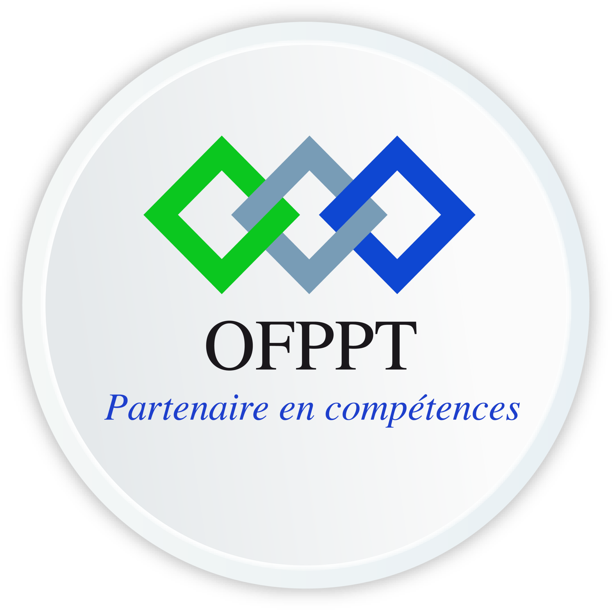
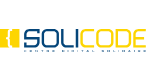
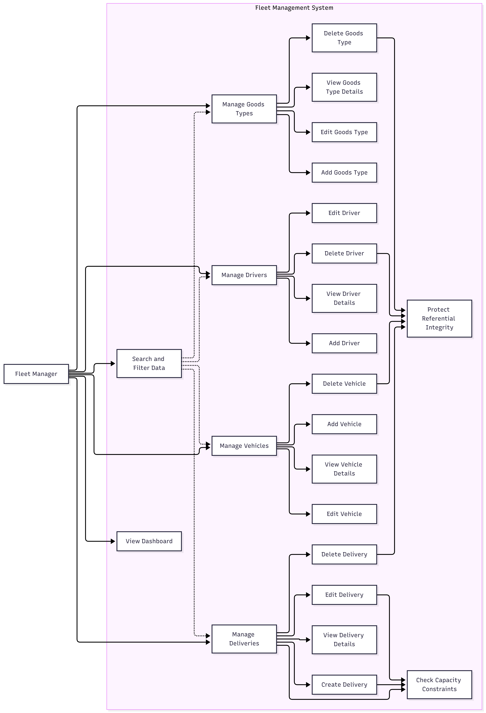
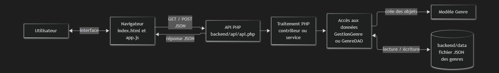
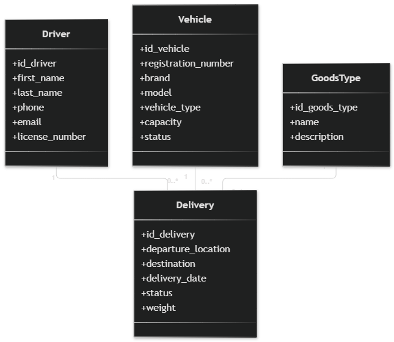

<!-- _class: title-slide -->

# Rapport de projet fil rouge

  
  

Oussama Bekkali  
Encadrant : ES-Sarraj Fouad

---

## Remerciements

---

## Introduction

---

## Contexte du projet

---

<!-- _class: image-only -->

## Méthode de travail

---

<!-- _class: image-only -->

## Scrum

---

<!-- _class: image-only -->

## Processus 2TUP

---

<!-- _class: image-only -->

## Design Thinking

---

## Planification

---

## Branche fonctionnelle

---

## Carte d'empathie

---

## Définition du problème

---

## Idéation

---

<!-- _class: diagram-slide -->

## Diagramme de cas d'utilisation

---

## Stack technologique

- **Backend** · PHP 8.2 · Laravel 12
- **Autorisations** · Spatie Laravel Permission
- **Mobile** · NativePHP
- **Frontend** · Blade · Tailwind CSS · Alpine · Preline · Vite
- **Base de données** · MySQL
- **Diagrammes** · Mermaid · PlantUML

---

## Architecture

---

## Maquettes

---

<!-- _class: diagram-slide -->

## Diagramme de classes

---

## Realisation

---

## Conclusion
